<div align="center">



<br />
<br />

# Mahdi Ghahremani (TheLouisMahdi)

### Electrical Engineering Student, University of Zanjan | Embedded Software at Fartak Control | FPGA & Computer Vision

### [Open the interactive EKA Windows 7 portfolio](https://thelouismahdi.github.io/TheLouisMahdi/)

<a href="https://github.com/TheLouisMahdi">
  
</a>
<a href="https://t.me/thelouis_mahdi">
  
</a>


<br />
<br />


</div>

---

## 🖥️ Interactive EKA Windows 7 Portfolio

The profile header is a browser-based Windows 7 simulation with an EKA BIOS and boot sequence, Explorer and persistent virtual files, Notepad Save As, CMD and PowerShell, Python execution through WebAssembly, a Windows 7-style Paint ribbon with nine brush engines and brush-specific sizes, Control Panel Personalization with Aero/basic/high-contrast themes and wallpaper slideshows, working desktop gadgets, taskbar flyouts and shortcuts, responsive touch controls, and a smooth manually detachable thermal profile receipt.

Five playable Windows 7 games are included: **Solitaire**, **FreeCell**, **Minesweeper**, **Chess Titans**, and the **Purble Place: Comfy Cakes** recreation. The classics can be launched from Start, the taskbar after opening, Run, CMD, or PowerShell; Purble Place is available from Start and the taskbar.

Try saving `Hello.py` on the virtual Desktop and running either `python Hello.py` or `py Hello.py` from Command Prompt.

---

## 👨‍💻 About Me

I'm **Mahdi Ghahremani** (**TheLouisMahdi**), an **Electrical Engineering student at the University of Zanjan** working in **embedded software and engineering tools at Fartak Control**. My main interests are **STM32 and FreeRTOS**, **C/C++**, **FPGA acceleration**, **computer vision**, and **hardware-software co-design**.

My work connects real devices to reliable software: embedded debugging, industrial communications, memory and resource analysis, and Windows engineering applications for electrical protection equipment. I also build practical software tools and experiment with hardware-accelerated AI.

For my bachelor's project, I'm developing an **INT8 CNN inference pipeline for a Zynq-7020 SoC**, combining ARM Cortex-A9 software with FPGA programmable logic. Live-camera integration and on-board inference are still **under development and verification**.

I have also used the names **poimu**, **eka**, and **Eka Francium** online. Some industrial projects cannot be shared publicly because they involve company-owned code or hardware.

---

## 🧭 Professional Work & Collaborations

### ⚙️ Fartak Control | Embedded Software & Engineering Tools

I work on software for **power-distribution automation equipment**, including **FC22 reclosers and sectionalizers**. My work involves STM32-based systems, FreeRTOS, C/C++, communication troubleshooting, device configuration, and desktop tools for measurements, protection settings, event decoding, and signal inspection.

Other team work mentioned in this portfolio:

<table>
<tr>
<td width="50%">

### 🏝️ Three Islands Team

Technical leadership, system design, and engineering coordination.

</td>
<td width="50%">

### 👁️ Rast Eye

Applied computer vision, software, and AI engineering.

</td>
</tr>
</table>

---

## 🎓 Bachelor's Project | Zynq FPGA Inference

**Target:** ALINX AX7Z020B (Xilinx Zynq-7020 / XC7Z020)

- **Goal:** Camera-based vigilance and fatigue-state classification.
- **Compute:** ARM Cortex-A9 (bare-metal) and FPGA programmable logic with an INT8 CNN accelerator.
- **Interfaces:** AXI DMA, AXI4-Lite, AXI-Stream, and a Python host application.
- **Tools:** Vivado, Vitis, Vitis HLS 2023.2, C/C++, Python, and hardware simulation.
- **Status:** Hardware and software integration is in progress; successful inference on the physical board has **not yet been verified**.

The public [FPGA CNN Fatigue Monitoring](https://github.com/TheLouisMahdi/fpga-cnn-fatigue-monitoring) repository is an **earlier Python/Verilog feature-extraction prototype**, not a claim of completed deployment of this newer Zynq system.

---

## 🚀 Focus Areas

<table>
<tr>
<td width="50%">

### 👁️ Computer Vision

- Image processing
- Object detection and recognition
- Visual monitoring systems
- Feature extraction
- Camera-based intelligent systems

</td>
<td width="50%">

### 🧬 Applied AI

- Deep learning workflows
- Model training and evaluation
- Pattern recognition
- Classification and prediction models
- AI-assisted engineering systems

</td>
</tr>
<tr>
<td width="50%">

### 🔧 Embedded & Industrial Systems

- STM32 firmware and FreeRTOS
- Memory diagnostics and leak tracing
- Device communication and debugging
- Industrial measurement and control
- Electrical protection engineering tools

</td>
<td width="50%">

### ⚙️ FPGA & Digital Systems

- Zynq SoC and ARM/FPGA partitioning
- Verilog RTL and HLS development
- AXI DMA and streaming interfaces
- Hardware/software integration
- Verification and performance debugging

</td>
</tr>
</table>

---

## ⚡ Electrical Engineering Core

<table>
<tr>
<td width="33%">

### 🔌 Embedded Hardware

- STM32H7 and STM32F1 development
- FreeRTOS tasks, memory, and scheduling
- Embedded C/C++ and ST-LINK debugging
- Sensors and device communications

</td>
<td width="33%">

### 🧠 Digital Logic + FPGA

- Zynq-7020 and Cortex-A9 co-design
- Verilog RTL and HLS accelerators
- AXI4, AXI DMA, and AXI-Stream
- Vivado, Vitis, and hardware verification

</td>
<td width="33%">

### 🧪 Circuit + Simulation Work

- Schematic design and circuit analysis
- Hardware/software co-design
- Simulation-driven debugging
- Engineering documentation and validation

</td>
</tr>
</table>

---

## 🧩 Selected Projects

<table>
<tr>
<td width="50%">

### ⚡ <a href="https://github.com/TheLouisMahdi/devolf">DEVolf</a>

A Windows engineering console for Fartak Control FC22 reclosers and sectionalizers, covering live measurements, protection settings, events, signal analysis, and diagnostic reports.

</td>
<td width="50%">

### 🧠 Zynq-7020 INT8 CNN (ongoing)

Bachelor's project integrating ARM Cortex-A9, FPGA acceleration, AXI DMA, and a Python camera host. Board-level integration is still in progress.

</td>
</tr>
<tr>
<td width="50%">

### 🟢 <a href="https://github.com/TheLouisMahdi/npvt-terminal-converter">NPVT Terminal Converter</a>

A local-first browser tool for converting between NPVT containers, V2Ray-style links, and Xray/V2Ray JSON profiles.

</td>
<td width="50%">

### 🧠 <a href="https://github.com/TheLouisMahdi/lights-out-gf2-solver">Lights Out GF(2) Solver</a>

An offline puzzle engine and solver built around linear algebra over GF(2), custom board generation, and automatic solving.

</td>
</tr>
<tr>
<td width="50%">

### 🎬 <a href="https://github.com/TheLouisMahdi/VideoX_Compressor">VideoX Compressor</a>

A Windows video-compression tool using FFmpeg with NVIDIA, Intel, AMD, and CPU processing paths for classes, tutorials, and screen recordings.

</td>
<td width="50%">

### 🦎 <a href="https://github.com/TheLouisMahdi/LizardSpace">Lizard Space</a>

A small offline Windows sound application with global keyboard reactions, system-tray controls, and Windows startup support.

</td>
</tr>
<tr>
<td colspan="2">

### 🔶 <a href="https://github.com/TheLouisMahdi/fpga-cnn-fatigue-monitoring">FPGA CNN Fatigue Monitoring</a>

A Python + FPGA co-processing prototype where Python handles the computer-vision pipeline and Verilog RTL accelerates CNN-style feature extraction from eye and mouth ROIs, with ModelSim-based accelerator verification.

</td>
</tr>
<tr>
<td colspan="2">

### 🌐 <a href="https://github.com/TheLouisMahdi/proxy-speed-tester">Proxy Speed Tester</a>

A Python HTTP CONNECT proxy validator that measures tunnel latency and HTTPS transfer speed for authorized upstream-proxy testing.

</td>
</tr>
</table>

---

## 🛠️ Tech Stack & Tools

<div align="center">


</div>

---

## 🎯 How I Build

I prefer an engineering workflow that is **measurable and reproducible**:

```text
Understand -> Isolate -> Implement -> Test -> Verify
```

I favor minimal changes, small modules, hardware-aware debugging, and testing on the actual target before claiming a system works. I care more about correctness, resource usage, and maintainability than inflated skill percentages or feature counts.

---

## 🧠 How I Think

I usually start with ideas. When I see a system, I naturally think about how it could be improved, rebuilt, simplified, or solved in a better way.

I enjoy the process of struggling with problems, testing different paths, failing, fixing, and pushing forward until the work is finished.

---

## 📬 Contact

<div align="center">

I only use Telegram for social communication.

<a href="https://t.me/thelouis_mahdi">
  
</a>

<br />
<br />

```txt
Telegram ID: @thelouis_mahdi
GitHub:      TheLouisMahdi
Name:        Mahdi Ghahremani
University:  University of Zanjan
```

</div>

---

<div align="center">

### The most enjoyable thing in the world for me is learning.

</div>
